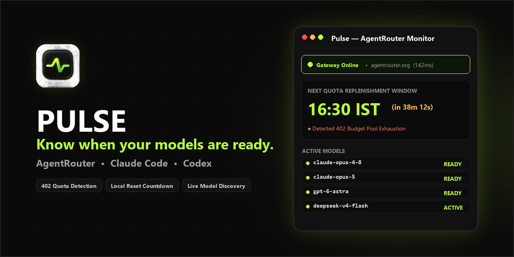

# PULSE

> **Know when your models are ready.**

[-B8FF3D?style=flat-square&logo=windows&logoColor=0A0A0A&labelColor=111111)](https://github.com/MrTG1B/Pulse/releases/download/v1.1.0/Pulse.exe)
[](https://github.com/MrTG1B/Pulse/releases/latest)
[](https://agentrouter.org)
[-0078D6?style=flat-square&logo=windows)](https://github.com/MrTG1B/Pulse/releases/latest)
[](LICENSE)
[](tests)

[ **Download for Windows** ](https://github.com/MrTG1B/Pulse/releases/download/v1.1.0/Pulse.exe) • [ **User Guide** ](docs/USER_GUIDE.md) • [ **Security Policy** ](docs/SECURITY.md) • [ **GitHub Release** ](https://github.com/MrTG1B/Pulse/releases/tag/v1.1.0)



**Pulse** monitors AgentRouter availability for developers using **Claude Code** and **Codex**.

```text
┌───────────────────────────────────────────────┐
│ ● GPT-6.1 Sol                  RECOMMENDED    │
│   Unlimited · all day · live multiplier       │
│                                               │
│ Latest notice: Opus 5.5 temporarily offline    │
│ Models, notices & usage sync automatically    │
└───────────────────────────────────────────────┘
```

### Stop checking AgentRouter manually.
Getting **`402 Budget pool quota has been exhausted`** on AgentRouter?  
Pulse follows AgentRouter announcements, your live account models, and gateway connectivity. Quota countdowns appear only when a model has published release times.

---

## ⚡ Why Pulse?

When you're building with **Claude Code**, **Codex**, or AgentRouter API tokens, shared budget pools run dry during peak hours. Manually sending test prompts or refreshing status dashboards wastes time and disrupts your coding flow.

Pulse runs as a lightweight, always-on-top desktop widget that sits alongside your IDE or terminal. It monitors AgentRouter availability in the background at a configurable polling interval, updates models and notices automatically, displays reported API-key usage, and shows a local-time countdown for published quota drops.

### Features
- **AgentRouter Availability Polling**: Background health and latency benchmarks at configurable intervals directly against `agentrouter.org`.
- **HTTP 402 Quota Detection**: Instantly recognizes budget pool exhaustion and provides 1-click fallback to uninterrupted models.
- **Local Timezone Countdown**: Precision countdown tickers to the selected model's current published release times.
- **Compatible AgentRouter Client Headers**: Uses authentic client identification profiles (`claude-cli/1.0.108`) to ensure seamless interoperability for Claude Code and Codex workflows.
- **Automatic Models & Notices**: Refreshes `/v1/models`, public pricing and dated announcements every five minutes, with **Sync Now** for immediate updates. Model removals, supply changes, aliases and recommendations update the UI automatically.
- **Reported Usage**: Displays API-key credit usage and key caps. Shows recent per-model input/output token counts when logs are returned; unreported model balances stay unknown.
- **Cached Provider Data**: Keeps the last successful model and notice data during outages and visibly marks stale data.
- **Windows DPAPI Local Key Encryption**: Pulse encrypts AgentRouter API keys at rest using Windows Data Protection API (`CryptProtectData`). The encrypted value is bound to the Windows user context and is not stored as plaintext.
- **Always-on-Top Floating Widget**: Sleek, distraction-free desktop window with a 1-click compact mini-dock mode.

---

## 🔄 Current Supply & Quota Behavior

AgentRouter's latest dated notice says **Claude Opus 5.5 is temporarily unavailable**, **GPT-6 Astra is unlimited all day**, and **GPT-6.1 Sol is unlimited at a low multiplier and recommended first**. Pulse fetches the live account catalog and pricing rather than assuming every model is available to every token.

Unlimited and suspended models have no quota refill countdown. If a later announcement limits a model and publishes release times, Pulse calculates that model's local countdown and updates any enabled auto-focus jobs. A restored model is checked again instead of reusing an old quota schedule.

Dated announcements take priority over the older `/api/notice` text. If a refresh fails, Pulse keeps the last good data and retries automatically.

---

## 🔍 Solving Common AgentRouter Issues

| Issue / Search Query | What It Means | How Pulse Solves It |
|---|---|---|
| **`402 Budget pool quota has been exhausted`** | The requested model or shared provider pool has exhausted its budget. | Uses the selected model's published release schedule and offers an available fallback. |
| **`401 unauthorized client detected`** | Gateway rejected unrecognized or bare HTTP headers. | Automatically sends authentic, compatible client headers (`claude-cli/1.0.108`). |
| **`503 no available channel in group`** | Model is not routed in your token's assigned channel group. | Reconciles the live account catalog and offers another available model. |
| **AgentRouter Claude Code connectivity** | CLI coding tools fail silently during pool outages. | Float Pulse next to VS Code / terminal to know when Claude is ready before running commands. |

---

## 📦 Download & Quick Start

### Option 1: Standalone Windows App (No Python Needed)
1. Download **[Pulse.exe (v1.1.0)](https://github.com/MrTG1B/Pulse/releases/download/v1.1.0/Pulse.exe)** .
2. Double-click to launch. No installer, no terminal window, no dependencies.
3. Click **Enter Key** in the top bar to paste your AgentRouter API key (`sk-...`).

### Option 2: Run from Python Source
```powershell
# 1. Clone the repository
git clone https://github.com/MrTG1B/Pulse.git
cd Pulse

# 2. Install dependencies
pip install -r requirements.txt

# 3. Launch the desktop widget
python app.py

# Or launch in web browser mode
python app.py --browser
```

---

## 🔒 Security & Key Protection

Pulse is designed with zero-telemetry and local-first security principles:
- **Windows DPAPI Encryption**: Pulse encrypts AgentRouter API keys at rest using the Windows Data Protection API (`CryptProtectData` via `crypt32.dll`). The encrypted value is bound to the Windows user context and is not stored as plaintext.
- **No Key Exposure Over Local API**: Local HTTP endpoints never return raw API keys over the network (only `has_api_key` and masked strings).
- **No Analytics Telemetry**: Model and usage data stays local. Optional Gemini verification can send candidate window titles and screenshots to Google when enabled; the interface also loads Google Fonts.
- **Masked Credentials**: Keys are masked across all UI views (`sk-••••••••1234`).
- **Git-Safe**: `config.json` is explicitly gitignored.

For full disclosure and vulnerability reporting, see [SECURITY.md](docs/SECURITY.md).

---

## 🎯 Live Models & Usage

The model list follows your account token. Current provider policies include:

| Model ID | Supply | Behavior |
|---|---|---|
| `gpt-6.1-sol` | Unlimited | Recommended; live low multiplier |
| `gpt-6-astra` | Unlimited | Available all day; no scheduled refill |
| `claude-opus-5-5` | Temporarily unavailable | Disabled until AgentRouter announces restoration |
| Other account models | As reported | Added automatically; unknown quota policies remain unknown |

Use **Sync Now** to refresh immediately. Automatic metadata and usage synchronization continues when **Auto-check** is off; connection diagnostics remain separately controlled.

The **API-Key Credits & Model Usage** panel displays the figures returned by AgentRouter. Billing credit usage is separate from raw token counts. An uncapped API key does not report the user's remaining account balance. Recent model logs, when returned, are a partial history rather than lifetime totals. Shared model pool quotas and remaining tokens are marked **not reported** when the API does not expose them.

---

## 🗺️ Product Roadmap: Availability-Aware AI Coding Automation

Pulse is built as the availability engine for AI coding workflows:

```text
             PULSE
               │
        Availability Engine  (v1.1 — Current)
               │
        ┌──────┴──────┐
        │             │
   Claude Code      Codex
        │             │
        └──────┬──────┘
               │
          Task Queue         (Planned)
               │
          Scheduler          (Planned)
```

- **v1.1 (Current)**: Automatic model, notice and usage synchronization, model-specific quota tracking, DPAPI security, and a floating desktop widget.
- **Future Releases**: Automated task queue that queues Claude Code and Codex prompts during quota dry spells and automatically executes them the second capacity refreshes.

---

## 📁 Repository Structure

```
Pulse/
├── src/                    # Core Python application modules
│   ├── app.py              # Desktop window launcher (WebView2)
│   ├── server.py           # Local loopback server & API routes
│   ├── router_client.py    # Gateway diagnostics & model discovery
│   ├── provider_updates.py # Background models, pricing, notices & cached policies
│   ├── usage_service.py    # Reported API-key credit and recent model usage
│   ├── scheduler.py        # Model-specific quota release focus jobs
│   ├── focus_trigger.py    # Optional Codex / Claude Code window controls
│   ├── gemini_helper.py    # Optional AI verification & narration
│   ├── time_service.py     # Quota schedule math & timezone calculations
│   └── config_manager.py   # Windows DPAPI encryption & config persistence
├── static/                 # Frontend UI web application
│   ├── index.html          # Widget markup & in-app help guide
│   ├── style.css           # High-contrast dark theme
│   ├── widget.js           # Reactive UI controller & Web Audio
│   └── icon.png            # Webview asset
├── assets/                 # Brand assets & preview media
│   ├── icon.png            # High-resolution master icon (PNG)
│   ├── icon.ico            # Multi-resolution Windows app icon (ICO)
│   └── social_preview.png  # 1280x640 GitHub social preview card
├── docs/                   # Guides & policy documentation
│   ├── USER_GUIDE.md       # Complete user manual & troubleshooting
│   ├── SECURITY.md         # Encryption architecture & security policy
│   ├── CONTRIBUTING.md     # Setup instructions & developer guidelines
│   └── CHANGELOG.md        # Version history & release notes
├── scripts/                # Build & release automation
│   ├── build_exe.py        # PyInstaller standalone build script
│   ├── build.bat           # 1-click Windows build batch file
│   ├── generate_social_preview.py # Social card generator
│   └── publish_release.py  # GitHub Release publishing automation
├── tests/                  # Automated test suite (135/135 passing)
├── app.py                  # Root launcher entrypoint
├── requirements.txt        # Python package dependencies
└── LICENSE                 # MIT License
```

---

## 🧪 Testing

Pulse maintains 100% test pass rates across all modules:

```powershell
python -m unittest discover tests
```

Tests cover encrypted keys, gateway classification, notice precedence, model aliases, account isolation, cache recovery, background refresh, reported credit units, recent token logs, model-specific schedules, desktop behavior, and local REST endpoints.

---

## 📄 License

Distributed under the [MIT License](LICENSE).  
Target Gateway: **[AgentRouter](https://agentrouter.org)**.
